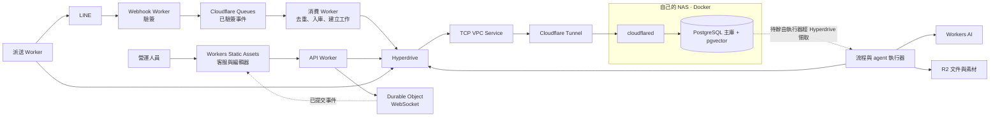

# Botlyn 全站與 AI 客服重構提案

2026-11-27 · NAS 架構修訂版 · 第二版視覺原型　[逐頁檢視全部畫面](screens.html) · [開啟離線互動原型](index.html) · [總覽預覽圖](overview.png) · [Cloudflare 遷移評估與估價](Cloudflare遷移評估.md)

## 建議先做的決策

1. **讓對話成為工作入口。** 客服打開工作區就能看到待接手案件、判斷依據和上一則回覆。製作者從同一個 Bot 進入知識、流程和 Flex。新建 Bot 的使用者走連線精靈，有既有 Bot 的使用者進營運總覽。
2. **在 Cloudflare Worker 上採用可恢復的 TypeScript agent loop。** 固定規則優先，模型在獲准的工具範圍內決定下一步。平台擁有身分、接管權、版本、執行預算與訊息送出權。保留搜尋和向量檢索作為可評測的工具。文件名稱、原文段落和版本構成可以核對的回答依據。
3. **沿用 NAS Docker 的 PostgreSQL 主庫，LINE 訊息一筆一列。** Worker 經 Hyperdrive、TCP VPC Service 與 Cloudflare Tunnel 存取。LINE webhook 驗簽後先寫 Cloudflare Queues，NAS 短暫離線仍可收件。 客服接手、流程版本、AI 執行與發送狀態有共同的一致性需求。R2 保存原始檔與媒體，Workers AI 提供推論。Redis 的事件去重、快取與即時通知分別遷移，並依 Bot 完成 MongoDB 對帳與退役。各責任的切換條件見 [Cloudflare 遷移評估](Cloudflare遷移評估.md)。

本版沿用 **Botlyn** 名稱，採用新的三道斜線字標。根目錄另有 BotCraft 的歷史設計及獨立展示頁。預載的「島嶼選物」頻道包含客服例外和交接案件。也可建立獨立的空白示範頻道。原型有 31 個可切換畫面，重新整理會還原示範資料。這是原始碼盤點和本機原型驗證，正式環境的用量、延遲、模型品質與用戶任務時間仍待量測。

## 先體驗三條路徑

| 從這裡開始 | 實際可以操作 | 請留意 |
|---|---|---|
| 營運總覽 → 林以晨 | 展開 AI 工具紀錄，開啟引用來源，回收件匣接手後回覆 | 先知道「為何要我處理」，接手才出現輸入框 |
| 知識庫 → 新增文字來源 | 貼文或讀入本機 TXT／Markdown，建立草稿、發布、測試來源，從測試結果返回文件 | 讀入只發生在瀏覽器記憶體；正式匯入需支援原有 PDF、DOCX、TXT |
| 流程編輯器 → 回覆 Flex 訊息 | 改標題，看手機預覽、儲存、返回流程，用命中／未命中的文字測試，再發布草稿 | 改變條件或樣板會使先前測試失效 |

逐頁檢視器提供桌面與手機實際截圖。點選後可在框內操作，也可用上一頁、下一頁切換。從工作台按 ⌘/Ctrl K 可檢視公開頁、帳號狀態、404、各編輯器與頻道精靈。示範會在本機比對問題和文件，呈現預定的工具呼叫結果。真實模型、LINE、憑證、外部發送、全種類節點的正式編譯、政策核定與後端權限屬後續實作範圍。

第二版另提供 [頻道管理](index.html#channels) 與 [設計資產](index.html#assets)。可以新增、切換、移除示範頻道，也可以建立、複製或切換流程、Flex 和圖文選單。

## 頁面盤點與資訊架構

檢查範圍含 React 入口中的 **25 個路由宣告、22 個頁面元件**，包含萬用路由、兩個信箱驗證別名，以及建立 Bot 的轉址。另檢查編輯器五個子頁、首頁展示、工作區的對話與 Bot 管理面板，以及獨立的 Landing Page.html。以下的原型入口以 # 開頭，便於逐頁核對。[路由與載入入口](../../frontend/src/home.tsx) · [原產品首頁](../../frontend/src/features/home/pages/HomePage.tsx) · [獨立展示頁](../../Landing%20Page.html)

| 現行入口 | 讀到的工作／狀態 | 新入口與保留行為 |
|---|---|---|
| / | 品牌首頁、功能示範、建立引導、登入後回工作台 | [產品首頁](index.html#home)；給訪客可實際試用的收件匣，登入者恢復工作位置 |
| /login | 帳密、記住我、LINE、忘記密碼 | [登入](index.html#login)；保留原工作目標和回跳路徑 |
| /register | 建帳、條款、驗證信、LINE | [註冊](index.html#register) → 等待驗證 → 首次連線 |
| /line-login | LINE 登入入口及已登入狀態 | [LINE 登入](index.html#lineauth)；整合為登入頁上的方法，保留深連結 |
| /login-success、/login-error | 回呼、載入與錯誤復原 | [成功](index.html#success)／[失敗](index.html#error)；成功導回原任務，錯誤可重試 |
| /forgetthepassword、/reset-password | 申請信件及以 token 設新密碼 | [忘記密碼](index.html#forgot)／[重設](index.html#reset)；區分已申請、連結失效、完成 |
| /email-verification-pending | 無信箱資訊、等信、重寄 | [等待驗證](index.html#pending)；顯示目標信箱、重寄冷卻、返回入口 |
| /verify-email、/email-verification | 兩個路徑共用 EmailVerification，處理成功和過期 | [驗證結果](index.html#verify)；舊信件、token 查詢參數及回呼繼續可用 |
| /dashboard | HomeBotfly 管理 Bot、檢視詳情、編輯、啟停及刪除 | [營運總覽](index.html#overview) + 固定 Bot 選擇器；Bot 級操作集中頻道設定，保留管理權限與刪除確認 |
| /bots/create → /dashboard?createBot=1 | 透過 dashboard 開啟建立表單 | [連線精靈](index.html#connect)；舊轉址可進入精靈，三步內走到第一則測試 |
| /bots/management | AnalyticsTabContent、LINE Insight、本地互動、用量與即時更新 | [成效分析](index.html#analytics)；同一期間與 Bot，指標註明來源和延遲；保留配額、活動及連線詳情 |
| /bots/user-management | 好友選取、詳情、選擇性廣播及 ChatPanel | [好友](index.html#contacts)處理分眾，[收件匣](index.html#inbox)處理個案；同一好友可往返兩者 |
| /bots/visual-editor · 基本資料 | Bot 憑證、健康檢查、Webhook | [頻道連線](index.html#connection)；憑證與連線診斷集中 |
| 同一路由 · 邏輯 | 模板清單、畫布、屬性、程式預覽、儲存狀態 | [流程編輯器](index.html#flow)；保留模板、復原、程式檢視，增加已發布／草稿區別 |
| 同一路由 · Flex | 設計積木、屬性、手機預覽與儲存 | [Flex 訊息](index.html#flex)；由引用節點直接開啟，再回同一流程、節點與縮放位置 |
| 同一路由 · preview | 實際標籤是「AI 知識庫管理」，內含接管、文件上傳、搜尋、刪除與進度 | [知識庫](index.html#knowledge)維護資料，[AI 助理](index.html#agent)管理政策和測試；從引用可返回來源 |
| 同一路由 · richmenu，以及 /bots/management/richmenu | 編輯器內與獨立頁均可進入圖文選單 | [圖文選單](index.html#menu)；共用選單清單、素材、熱區編輯、預覽、預設選單與發布入口 |
| /how-to-establish | 註冊 Developers、建 Provider、建 Channel、取金鑰四步 | [教學](index.html#guide)保留深連結；精靈在需要憑證時提供對應步驟 |
| /setting | 頭像、個人資料、電子郵件、第三方綁定、密碼、刪帳 | [帳號設定](index.html#account)；整理為個人、安全與連結帳號、資料管理 |
| /language | 繁中／英文偏好 | [介面語言](index.html#language)；正式版本沿用既有偏好和雙語資源 |
| /about、/suggest | 關於、用途、回饋類型、聯絡方式 | [關於](index.html#about)／[意見回饋](index.html#feedback)；公開入口與登入後支援共用內容 |
| /terms、/privacy | 同一 LegalPage，讀取不同的條款或資料處理摘要 | [條款](index.html#terms)／[隱私](index.html#privacy)；沿用核定全文，更新日期與章節錨點可見 |
| * | 依登入狀態返回工作台或首頁 | [404](index.html#missing)；保留回到可操作位置的出口 |
| 根目錄 Landing Page.html | BotCraft 品牌、功能、價格、FAQ、展示畫布；未掛 React 路由 | 以產品首頁為品牌發行來源。價格與方案先向產品資料核對，避免歷史展示被當作承諾 |

**導覽的資料單位是 Bot。** 正式工作區建議用 /bots/:botId/inbox/:conversationId、/bots/:botId/flows/:id、/bots/:botId/knowledge/:id 等可分享網址。帳號與語言偏好維持個人層級。切換 Bot 要清除前一 Bot 的快取、選取、WebSocket 訂閱與未送出的對話草稿顯示；草稿鍵包含 Bot 與資源 ID。舊網址按授權、既有選擇或 Bot 選擇頁解析，拒絕猜測使用者無權存取的 Bot。[既有 Bot 選擇狀態](../../frontend/src/features/bots/context/SelectedBotContext.tsx) · [工作區頁籤](../../frontend/src/features/visual-editor/components/Workspace.tsx)

### 視覺、操作與可用性標準

- 本版使用鈷藍 #384BE4、墨黑 #171923 與霧白 #F6F6F8。品牌金屬摺環用於首頁、登入與營運指標。Flex 與選單使用真實感商品攝影，方便評估素材、文字和按鈕的位置。內容區使用同一組表格、文件讀取面板、表單欄位及標題動作位置。高密度資料的色彩只表達選取、需要處理、發布狀態及圖表系列，每個狀態都有文字。
- 2026 年 Linear 的介面調整把當前位置與頁面動作放在可預期的位置。這份原型將 Bot 和導覽放在固定工作區，測試與發布靠近被操作的資源。客服可以從一則對話取得引用與接手權，製作者可以從樣板回到引用流程。[Linear 2026 設計回顧](https://linear.app/now/behind-the-latest-design-refresh)
- 動效用原生 CSS 完成頁面出現、對話框進場及堆疊條圖展開。一般狀態過渡約 150–200 ms，初次圖表每根長條約 550 ms，依序進場。reduced-motion 模式直接呈現結果。此預覽可離線開啟，因此毋須為動畫下載 GSAP。
- 桌面保留常用入口，窄螢幕用導覽搜尋、單欄順序和可橫捲表格。工作區標示、語意標籤、鍵盤焦點、可關閉的對話框、表單錯誤提示與狀態文字納入元件共用規格；正式版須用 VoiceOver、鍵盤、縮放與真機驗收。[WCAG 2.2 焦點可見性說明](https://www.w3.org/WAI/WCAG22/Understanding/focus-not-obscured-minimum.html)
- 原型 KPI 使用示範資料。正式量測先定義分母：AI 自助解決率建議為「有確認結案、且觀察期內未轉人工的 AI 案件／已完成觀察期的 AI 案件」；首次回覆自收到事件到第一筆 LINE 接受紀錄，同時顯示無回覆率。沒有足夠資料的 Bot 顯示空狀態或樣本數。
- 建議用 5 位客服／製作者各做首次設定、從例外接手、修正文件再驗證三項任務。先量舊版的完成率、耗時、中途求助與錯投頻道次數；新版的初始目標是每項至少 4/5 能獨立完成、跨 Bot 誤操作為零。這些是設計驗收目標。

## 現行後端實際在做什麼

| 路徑 | 程式證據 | 對設計的影響 |
|---|---|---|
| LINE → webhook → 規則 | process_single_event 讀 eventId、replyToken，先以 Redis GET/SET 標記，再寫好友與 Mongo 對話，然後呼叫 evaluate_and_reply。處理器以多個 session 併發。簽章比對包在「有 header 才驗」的條件裡。 | 事件驗簽並成功入列後確認收件。消費者以 PG 唯一鍵原子寫入，再執行規則。跨對話可並行，同一對話要決定順序。[Webhook](../../backend/app/api/api_v1/webhook.py) |
| 規則 → AI | 啟用中的模板按更新時間檢查。workflow graph 和舊積木兩條執行路徑並存，動作可以直接送出；action.aiTakeover 留下一個結果標記。AI 啟用且收到文字時，空結果或明確節點可觸發接管。 | 把規則結果改成具型別的「已處理、交給 AI、未命中、失敗」；判斷是否已送、如何移交與哪一方負責需獨立記錄。[規則引擎](../../backend/app/services/line/logic_engine_service.py) |
| AI → 模型與文件 | ConversationContextBuilder 讀取 Mongo 對話、近期訊息、滾動摘要、獨立問題與語意記憶。AITakeoverService 隨後在自主回答或查文件間路由。文件路徑讀最近最多 80 份摘要、最多選 3 份，每份截 9,000 字，總計 18,000 字；優先用 original_content，缺漏時讀 chunks。 | 真正要替換的是固定決策順序、截斷和缺乏可追溯引用。舊文件和長文尾端需納入回歸集。[上下文組裝](../../backend/app/services/conversation/context_builder.py) · [接管服務](../../backend/app/services/ai/ai_takeover_service.py) |
| 知識匯入 | 前端固定 project scope，支援文字及 TXT/PDF/DOCX。後端有文件、原文、chunks、MinIO 路徑、摘要和軟刪除。非同步處理工作存在程序內的 _active_jobs。 | 重用擷取器與既有檔案；新增版本、段落位置、持久任務、可重試的處理狀態。原本 bot_id 為空的來源要另查歸屬。[前端管理器](../../frontend/src/features/ai/components/AIKnowledgeBaseManager.tsx) · [知識處理](../../backend/app/services/knowledge/knowledge_processing_service.py) · [資料模型](../../backend/app/models/knowledge.py) |
| AI → LINE、聊天 UI | 背景工作持有 reply_token，實際走 send_flex_message 的 push 路徑；之後分別以文字記錄 Mongo、廣播 WebSocket。發送錯誤／失敗結果未作為這兩步的成功條件。排程使用程序內 priority queue，接管工作 max_retries=0。 | 工作重啟需恢復。區分生成、佇列、已被 LINE 接受、失敗與結果未知。客服應看得到當時真正送出的 Flex。[背景排程](../../backend/app/services/runtime/background_tasks.py) · [LINE 傳輸](../../backend/app/services/line/line_bot_service.py) |
| 對話與人工回覆 | ConversationDocument 將訊息放在一個陣列，add_message 先查、append、save。人工單發另寫 PG 的 AdminMessage 和 Mongo；儀表、聊天、統計、媒體更新及 WS 都用到這些形狀。 | 要盤點所有讀寫者、保留舊訊息 ID／媒體／管理員身分，並重建統計與斷線補讀。[Mongo 模型](../../backend/app/models/mongodb/conversation.py) · [對話服務](../../backend/app/services/conversation/conversation_service.py) · [人工發送與分析](../../backend/app/api/api_v1/bot_analytics.py) |

## 目標架構與執行契約

圖中虛線表示工作或通知的流向。所有資料庫連線都由 Worker 經 Hyperdrive 進入 NAS；cloudflared 從 NAS 主動建立 Tunnel。前端與 API 可分別切換，資料表、交易與異機備份沿用自管 PostgreSQL。只有派送端能將回覆送到 LINE。[NAS 連線與部署條件](Cloudflare遷移評估.md) · [私網資料庫連線](https://developers.cloudflare.com/hyperdrive/configuration/connect-to-private-database-vpc/)

### LINE 收件、回覆與人工接手

**一則訊息先確認三件事：它屬於誰、目前誰可以回覆、這次結果是否已送出。** 模型只在需要解讀語意與選取工具的步驟介入。固定的歡迎語、按鈕 postback、人工已接手的對話都有可預期的執行路徑。

1. **在 Cloudflare 收件。** 依 webhook 路由取得 Bot 的驗簽設定，驗證原始 body，再核對 destination。成功提交這批全部事件到入站 Queues 才向 LINE 回 2xx。部分入列失敗則回非 2xx，已成功的事件容許重送；空事件的合法連線驗證可直接成功。佇列只攜帶必要事件資料，超過單訊息上限的內容先寫私有 R2，再入列物件參照。兩次寫入均成功才確認，暫存物件涵蓋重試與死信處理窗口，未引用物件到期清理。[LINE webhook](https://developers.line.biz/en/docs/messaging-api/receiving-messages/) · [Queues 限制](https://developers.cloudflare.com/queues/platform/limits/)
2. **提交 NAS 主庫後才確認佇列消費。** 用 (bot_id, webhook_event_id) 唯一鍵，在一筆交易寫事件、訊息及待執行工作。重複事件沿用既有結果；消費者在交易提交後中斷也能安全重跑。每筆記錄事件時間、入口接收時間及提交序號。依 Bot 與對話取得短租約，核對接手世代與發布版本，在交易外執行。佇列允許亂序；遲到的舊事件補入歷史，遇到較新的回合或後來的人工接手則跳過自動回覆，撤回先到時以訊息 ID 留下撤回標記。群組／聊天室和個人對話分開授權。[Queues 投遞語意](https://developers.cloudflare.com/queues/reference/delivery-guarantees/)
3. **執行發行中的規則圖。** 命中固定流程時回傳明確動作或 reply plan。一次 graph traversal 所產生的多則合法訊息保有順序。未命中 + 政策允許，或明確的 AI 節點，才建立 agent_run。同一入站事件只建立一個主要回覆權，防止平行分支各自推送。
4. **運行有上限的迴圈。** 初始輸入只有本輪訊息、最少近期回合、Bot 規則和工具清單。模型回傳一批結構化工具請求、回覆提案或移交。逐項驗證並將結果附入 run 的觀察記錄，再讓模型決定要補讀另一段、要求澄清、提出答案或交接。相同查詢／游標沒有進展、模型不支援工具、資料失效或超限時，留下可讀原因並結束。建議起始預算為每輪最多 4 次模型決策、6 次工具讀取、12 秒總時限；按 provider 延遲、引用品質和 token 成本校調。
5. **送出與接手。** 回覆提案經 schema、證據、模板版本、LINE 長度與權限檢查後，交易內產生訊息與 outbox。人工接手以原子操作提升 epoch、取消未送出的自動任務，worker 送出前再檢查 epoch／期限。派送者以同一筆主庫交易核對 epoch 並把出站紀錄由 pending 改為 sending。對正在外送的訊息向客服顯示「已有一則傳送中」；外送一旦開始便不能保證撤回。等傳輸結果後才允許對同一事件補送。
6. **派送與顯示。** 合格且仍有效的 reply token 優先使用一次，並在內部截止時間前完成。需 push 時由 Bot 政策、收件資格與額度決定。只有支援 retry key 的 API 採用固定 key 重試；reply 回應不明時標為 unknown 交由對帳，禁止自動改用 push 再送一次。WS 輸出已提交的狀態，斷線依游標補讀。「已被 LINE 接受」和「使用者已讀」使用不同欄位。[LINE Reply API](https://developers.line.biz/en/reference/messaging-api/#send-reply-message) · [LINE 重試語意](https://developers.line.biz/en/docs/messaging-api/retrying-api-request/)

### NAS 離線與恢復

| 時點 | 使用者與平台的行為 |
|---|---|
| 建立或輪替 Bot | 現行 webhook 會從資料庫讀取 Bot 憑證。新入口需在啟用前先發布一份具版本的驗簽設定，包含 Bot、destination、啟用狀態及加密的 channel secret。建議放在專用私有 R2 bucket，解密金鑰使用 Worker secret。入口只讀、管理端獨立授權寫入。輪替與停用以入口設定生效為完成條件；查不到有效設定時拒收，不把未驗簽事件排隊。LINE 發送憑證與收件設定分開授權。[現行 webhook](../../backend/app/api/api_v1/webhook.py) |
| NAS 或 Tunnel 離線 | Webhook 仍可驗簽並收進 Queues。收件匣顯示「資料庫離線，訊息等待同步」及最後同步時間；接手、派送、儲存、發布暫停。消費者延遲重試，告警追蹤最舊事件、剩餘保留時間與死信數量。試點採 Paid 佇列，提議入站與死信各設 7 天；Free 固定 24 小時，Paid 最長 14 天。須在到期前完成處置。[Queues 保留期限](https://developers.cloudflare.com/queues/platform/limits/) |
| NAS 復線 | 先確認是可寫主庫，再受控排空一般與死信佇列。每筆補寫均檢查唯一鍵、撤回、接手與回覆時效，客服依游標補讀。過期案件列入待處理，由客服決定是否另行聯絡。媒體依 LINE message ID 補抓至 R2；來源已失效時標記附件無法取得。 |
| 回復到較早的 PG 備份 | 災難還原可能讓資料庫倒退到「已對外送出」以前。先暫停派送，核對最後可復原的 WAL、入站資料及外送結果。無法證實的外送標為待確認。正常消費後已清除的佇列訊息無法取代異機備份，須另量測可容許的資料損失與恢復時間。 |

| 工具 | 輸入與結果 | 平台如何界定可做的事 |
|---|---|---|
| knowledge.search | query、可選文件類型 → doc_version、段落、短摘錄、下一頁 | 由執行環境注入 Bot、租戶、發布範圍；中文可先用字元 n-gram／關鍵字，與向量混合做離線評測 |
| knowledge.read | doc_version、section_id／游標 → 有界原文、定位與下一段 | 由內部文件 ID 解析已獲授權的物件版本，從 R2 讀取；支援 PDF 頁碼、DOCX 標題／段號和純文字行號。不得由模型指定主機路徑或任意網址 |
| conversation.read_recent | before_seq、limit → 目前對話的訊息與可見角色 | 限目前對話與 Bot，可依授權讀單一附件。摘要附 covered_seq，可從事實紀錄重建；跨對話記憶預設關閉 |
| flex.render | 已發布 template_version、型別化欄位 → 合法的 Flex／altText 草案 | 限該 Bot 的資產；缺欄位回傳結構錯誤，允許修正一次或使用文字回覆 |
| handoff.request、reply.propose | 原因、必要上下文／文字或 Flex 草案、引用 → 終止結果 | 由平台寫入接手佇列或 outbox。模型拿不到 LINE token。對話、檔案及外部工具結果皆視為資料 |
| 業務工具（後續） | 例如 order.lookup 綁定後的訂單 ID → 履約狀態 | 每種工具有明確 input/output schema、逾時、授權、稽核與個資遮蔽。退款或改地址等外部寫入另訂人員／顧客確認與 idempotency key |

每個 run 記錄輸入事件、policy／模型／工具版本、工具名稱、耗時、來源 ID、結束原因與用量。呈現在客服 UI 的是可驗證的工具步驟、引用與結果。歷程避免長期抄錄原文、敏感參數或模型隱藏推理。工具再次取用及送出前檢查文件撤回權限；已撤回的來源進入重跑或移交。若模型提供一個未曾讀取的來源，驗證器要求補讀或停止回答。

### 知識庫的資料生命週期

製作者在知識庫上傳檔案 → Worker 核對 Bot 權限，將原檔寫進私有 R2 → NAS 主庫記錄文件版本、雜湊與解析工作 → 工作執行器產生可定位段落並供試問 → 製作者發布 → 客服從 AI 回覆點開當次讀過的原文。物件寫入成功但文件交易失敗時，用相同上傳識別碼續辦或清理暫存；成功解析的新版本先留在草稿。變更知識來源不會覆寫已發布的 Flex 或流程。

匯入 → 持久任務 → 解析與校驗 → 可預覽草稿 → 測試引用 → 發布版本 → 被流程或 run 引用 → 封存／撤回。每一份原檔有內容雜湊、原始物件、解析器版本、分段及來源位置。黃色狀態區分「解析中」「解析失敗」「搜尋索引還在建立」。解析失敗可重試同一 job，先前正式版繼續服務。上傳同檔可辨識重複；同名新檔需選擇建立新版本或另建文件。無法擷取文字的掃描 PDF 顯示可操作的處理方式。

更新索引與正式發布分兩階段，確認可讀之後原子切換版本。索引延遲時可用文件目錄與段落讀取。刪除／撤權同步排除搜尋、讀取、記憶快取、索引與衍生摘要，安排物件和備份的到期清理。舊文件若缺原檔則保留原文／chunks 的來源層級，缺頁碼時引用段落，避免虛構頁碼。bot_id 為空且無法證明擁有者的資料先列入管理員待處理清單。

### 為什麼目前選自建薄 harness

| 候選 | 本案的收益 | 必須承擔的代價與決策 |
|---|---|---|
| TypeScript Worker 自建薄層（目標方案） | 直接用 AI 和 R2 binding，透過 PG 記錄 run、引用版本與派送權 | 初期須移植與驗證工具合約、既有流程相容性，以及佇列重試與接手行為。[切換順序與成本](Cloudflare遷移評估.md) |
| Python 內建薄層（沿用舊後端時的備選） | 直接重用 FastAPI、SQLAlchemy、擷取器、MinIO 和 LINE adapter；模型及工具呼叫可替換 | 團隊須維護 provider tool-call 適配、取消、預算、checkpoint 與重播。用同一批對話驗證兩種 provider；未通過者維持受限能力 |
| Pi agent-core | 已有 agentLoop、工具、事件串流與模型介面，適合熟悉 TypeScript 的團隊 | 選用前需實測 Workers runtime 相容性、Workers AI 的模型適配、取消與持久化，再比較自建迴圈所需的程式量。[Pi agent-core](https://github.com/earendil-works/pi/blob/main/packages/agent/README.md) |
| 託管 harness／長執行 agent | 可把執行環境、session 與恢復交給服務供應商，適合長時間異步作業 | LINE 即時回覆仍須本地執行權和 outbox。須驗證資料駐留、失敗恢復、端到端延遲與成本。先用於離線文件整理也是可評估的範圍。[Anthropic 2026 架構](https://www.anthropic.com/research/managed-agents) |

這裡的 harness 指負責 run 生命週期、工具、預算與恢復的執行層。原需求未指定某一個同名「Harness Agent」專案。選型驗證可重播相同的入站事件、工具結果與故障，在各候選上比較成功率、P95 延遲、每次成功解決成本與取消後誤送。固定規則和需要工具選擇的任務分開量測。[工作流程與 agents 的設計方式](https://www.anthropic.com/research/building-effective-agents)

## 對話儲存決策

最常見的讀取是「依 Bot 列出等待處理的對話」「向前取 50 則訊息」「這個回覆用的是哪一版流程與文件」。最重要的寫入是「某人取得接手權後，排隊中的 AI 不能再代表他回覆」。這些工作同時涉及多個會獨立變動的實體。LINE 的彈性 payload 可以獨立存成 JSONB，無須因 Flex 或貼圖欄位變動就調整整個對話表。[PostgreSQL JSONB](https://www.postgresql.org/docs/15/datatype-json.html)

| 比較面向 | PostgreSQL，每則訊息一列 | MongoDB，每則訊息一份文件或有限大小的 bucket |
|---|---|---|
| 查最近訊息與長對話 | (conversation_id, seq DESC) 游標查詢，可順序補讀、個別遮蔽 | 複合索引與游標亦能達成。現有單對話內嵌無界陣列可能觸及 16 MiB 文件上限，且會放大讀取與併發更新成本。[MongoDB 文件限制](https://www.mongodb.com/docs/manual/reference/limits/#mongodb-limit-BSON-Document-Size) |
| 入站去重、人工接手、outbox | 唯一鍵、行鎖／版本比對與單庫交易，把多筆必要變更一次提交 | Mongo 支援多文件 ACID。即使改成一訊息一文件，若 Bot、模板、接手權或帳號仍橫跨 PG，兩庫間仍需異步補償。[MongoDB 交易](https://www.mongodb.com/docs/manual/core/transactions/) |
| 內容、媒體及分析 | 固定查詢欄位正規化，異質 LINE 序列化內容用 JSONB；媒體存物件，熱門報表用增量投影 | 異質文件與按租戶水平切分有吸引力；跨租戶聚合可另建分析投影。兩者都需要保存、刪除與重建策略 |
| 運維與重新評估 | 沿用現有 PG 與備份工具，初期優先簡單索引。只有實測需要才做分割區、讀副本和歸檔 | 若實測顯示極大量 append-only 流量、熱分片可有效分散，且有獨立訊息平台團隊，重比「Mongo 訊息庫＋PG 控制庫」的延遲與成本 |

**切勿把 Mongo messages[] 原樣搬成 PG 單列大 JSON。** 建議資料模型如下。現有 Bot 是以 user_id 擁有，第一階段可把該擁有者當隔離邊界。日後增加工作區成員角色需明確新增 membership 與授權規則。

| 實體 | 關鍵欄位、約束與用途 |
|---|---|
| conversations | bot_id、source_type、source_id 唯一；owner_mode、assignee、ownership_epoch、last_seq、last_activity。索引 (bot_id, owner_mode, last_activity DESC) 服務收件匣 |
| inbound_events | 唯一 (bot_id, webhook_event_id)，含 occurred_at、received_at、payload、處理狀態；reply token 視為短效機密並設過期。舊資料無 event ID 時採來源系統的穩定 ID，記明 provenance |
| messages | id、conversation_id、seq、event_id、actor、LINE message ID、type、payload JSONB、媒體 object key、時間、可見性；唯一 (conversation_id, seq)，有 LINE message ID 的入站資料另外設條件唯一索引。外送實際 payload 與可讀摘要分欄 |
| agent_runs／tool_calls | 一個輸入事件與一次正式決策的關聯、執行序號、租約、checkpoint、預算、工具結果參照和來源區段；sandbox replay 有自己的 run ID，外送能力關閉 |
| outbound_messages／delivery_attempts | 回覆提案、目的對話、owner epoch、方法、穩定邏輯鍵、狀態、provider request ID 與錯誤類型；嘗試可多次但同一用意只建一筆。傳輸狀態與對話、WS 記錄共享 message ID |
| documents／document_versions／sections | Bot／擁有者 ACL、不可變版本、雜湊、object key、解析器、段落定位、發布指標和撤回狀態；向量索引可重建 |
| flow_releases／flex_versions | 編輯稿可變、發布稿不可變、樂觀鎖 revision、依賴版本；每筆 run／外送帶 release ID，可回溯當時卡片 |

治理須包含 LINE unsend、使用者資料清除、帳號刪除、對話摘要與 embedding 的連動刪除。依 Bot 定義保留期，把 LINE 撤回事件對應到原始訊息 ID；對話與引用位置顯示「訊息已收回」。保留必須的技術結果與可刪除內容分開，禁止從摘要、重播或舊快取把已收回內容重新帶回。[LINE 收回事件](https://developers.line.biz/en/docs/messaging-api/receiving-messages/#processing-on-receipt-of-unsend-event)

### 驗證選型與搬移資料

1. **量基線。** 取得每 Bot 峰值事件率、P50/P95/P99 訊息大小、最長／最熱對話、保存期、讀寫比、同時客服數和現有成本。用脫敏分布在 PG 原型與「Mongo 一訊息一文件」上跑相同的併發、重送、長對話翻頁、接手競爭與報表。記錄 P95/P99、提交吞吐、磁碟與索引成長、故障恢復時間；以實測峰值的兩倍作壓測起點。任何容量推估均待基線確認。
2. **建立一致讀寫介面。** 先接 ConversationService 的 webhook、AI、規則、人工單發、選擇群發、媒體回填、分析、dashboard、WS 與聊天分頁。既有 Python 查詢腳本、刪除腳本及歷史 PG→Mongo 遷移腳本也列入相依清單。新訊息的格式、分頁、順序與舊 API 用契約測試固定。[歷史遷移工具](../../backend/scripts/migration/migrate_conversations_to_mongo.py)
3. **先捕捉增量再回填。** 有 replica set 時先取得可續接的 change stream token，再做快照與可重入 backfill；若部署不支援 change streams，用受控寫入閘門、可重播的 ingress journal 和短暫分 Bot 切換窗口。所有既有寫入者皆須經由同一條增量通道，不能依賴兩庫各寫一遍都成功。
4. **攤平並對帳。** 以 (舊 conversation ID, 舊 message ID) 唯一回填，缺 ID 的歷史項目用凍結快照內可重現的鍵；排序以舊時間與原陣列順序打破同時戳平手。保留 sender_type、管理員快照、媒體、follow/postback、原始 ID、時區與撤回狀態。舊 admin_messages 與 Mongo 重複資料用可證實的 ID／映射比對，模糊匹配送人工覆核。舊 AI 文字紀錄的實際 Flex 與接受狀態無從還原時標記「歷史狀態未知」。
5. **影子讀取與切流。** 按 Bot／日期／類型／角色對筆數、雜湊、順序、最近 50 則、媒體可讀率、管理員權限及報表。差異明細與增量 watermark 可追蹤。清理重複和無主資料後，先切小比例讀，再以單一寫入者世代切寫入。切換時排空舊佇列、取得最後 watermark、確認新讀者看得到最後一筆。
6. **可回退與退役。** 灰度期間保存新寫入的反向 journal，投影到舊讀模型並驗證追平。發現差異則暫停新 worker、排空在途外送、取得切換點，再切回已追平的讀寫路徑。僅切 UI 或切讀庫無法回復尚未投影的人工接手／發送狀態；此時保持新控制層或暫停自動發送。完成保留窗口、備份還原演練及差異清零後才安排退役。

## 流程與 Flex 編輯器如何一起改

製作者在流程節點選「固定回覆」或「交給 AI」 → 固定回覆可引用 Flex 草稿並預覽手機畫面，AI 節點選取准用知識來源、工具與移交條件 → 用測試對話看每一步及輸出 → 發布時鎖定流程、Flex 和工具政策版本。營運人員由收件匣開啟該次回覆，可看實際發布版本、文件引用、派送狀態與人工接手紀錄。

- **流程合約。** 初版可沿用 workflow-graph/v1 的 trigger、condition、action、ports 和順序。將 action.aiTakeover 對應到明確的 agent.invoke 控制轉移，第一版維持終止該分支；新增成功／待人工／逾時續接時，另發版本並要求明確選擇行為。向後相容舊事件、變數、wait、圖片、貼圖、postback、webhook、大小寫和多模板優先序。舊 graph 以 updated_at 排序的結果在遷移時凍結成明確 priority。[流程型別](../../frontend/src/features/visual-editor/types/workflow.ts) · [引擎](../../backend/app/services/line/logic_engine_service.py)
- **同一執行規格。** 編輯器提交 graph 與 revision，後端驗證入口、失聯節點、分支、循環上限、跨 Bot 資源與移交後的副作用。將動作先產生 ReplyPlan，再由單一 dispatcher 發送。預覽用相同 interpreter，外部呼叫替換為 fixtures；程式碼顯示由版本化 graph 衍生。把等待轉換成可恢復的計時點。Webhook 節點保留原管理者設定的授權範圍，透過有限時及稽核的 connector 執行。
- **版本與草稿。** 自動儲存帶 revision，衝突提示比較／另存副本。發布引用確切的 flow、Flex、接管政策及工具版本，執行時綁定同一份發行清單；每輪查文件再記錄實際讀到的 document_version。回滾只是切回上一發行指標，進行中的 run 依既定版本結束或明確取消，已撤權的資源仍須立即阻擋。
- **Flex 格式。** 現行資料同時有 content JSONB 和可選的 design_blocks，FlexMessage 的擁有者是 user_id，流程透過 flexMessageId 引用。建立一次轉換，保留原始 payload 作為不可變快照，輸出 bubble 或 carousel、altText、動態欄位 schema 與支援的動作。前端手機預覽、測試和正式外送都用同一份編譯結果；發布前做 schema 與 LINE 驗證，標示不同 LINE 客戶端可能有的版面差異。跨 Bot 共用舊樣板應換成明確授權的共用資產及引用清單。[編輯器讀存](../../frontend/src/features/visual-editor/components/VisualBotEditor.tsx) · [Flex 資料模型](../../backend/app/models/bot.py) · [LINE Flex](https://developers.line.biz/en/docs/messaging-api/using-flex-messages/)
- **舊資料轉換。** 為 legacy block array、workflow-graph/v1、只有 content 的原生 Flex、JSON 字串、舊 blocks 包裝、空／缺 design_blocks 以及無效引用各建 fixture。可以無損轉換的建立新草稿及前後快照；無法無損還原的保留原始 JSON／舊引擎唯讀檢視，允許複製修訂，禁止以空畫布自動覆寫。每個上線 Bot 先比對整組輸出和副作用意圖。
- **圖文選單。** 與 Flex 共用素材與動作選擇器，保留 LINE Rich Menu 自己的尺寸、熱區與預設／綁定生命週期。選單發出的 message 或 postback 可以直接帶入同一個流程模擬器。

## 分期交付與可驗收結果

| 順序 | 交付 | 切到下一階段的判準 |
|---|---|---|
| 0 · 測試 Bot 與 NAS | 確認設計任務、凍結舊格式、驗證私網 TLS 與主庫、建立隔離角色，演練從異機備份還原 | 可量測台灣流量的主庫讀寫延遲，確認還原時間與資料損失範圍，測試環境禁止正式派送 |
| 1 · 前端與 R2 | 先以 Static Assets 提供既有前端，搬運知識原檔、私有媒體及公開素材，保留舊代理網址 | 登入、深連結、編輯器與舊 LINE 圖片可用，確認資料歸屬、雜湊與增量，再分開切前端和儲存 |
| 2 · 收件、對話與接手 | 發布驗簽設定，建立入站佇列、PG 唯一鍵、待辦與派送紀錄，回填 Mongo 歷史並影子讀取 | 斷 Tunnel 仍能驗簽且成功收件。重啟、重送、亂序及死信重播後無額外訊息或派送；已接手案件保持人工 |
| 3 · 知識、agent 與編輯器 | 版本化文件、權限工具、Workers AI、執行軌跡、流程及 Flex 共用模擬器、客服即時通知 | 新 loop 僅產生提案。測繁中引用、轉人工、每案成本、模板相容、衝突、撤權與 WebSocket 斷線補讀 |
| 4 · 逐 Bot 切換 | 分別切讀寫、派送與接管。每個 Bot 只有一個正式派送者，完成 UI、舊格式和發布版本驗收 | 取得資料切換點，驗證新寫入反向追平。回退時先暫停並排空派送，再切回已追平版本 |
| 5 · 收尾與退役 | 補齊全站、精靈、雙語、分析、郵件與剩餘 FastAPI 路由。依據對帳及用量陸續退役 MinIO、MongoDB、Redis、舊模型金鑰與後端 | 舊服務讀寫與外部模型呼叫歸零，備份可還原、功能覆蓋和觀察窗口皆通過。NAS 的 PG 與 cloudflared 繼續維護 |

**首批驗收案例。** 以有標註預期行為的脫敏案例涵蓋固定命中、未命中轉 AI、明確 AI 節點、問候無需工具、跨回合指代、前 80 份以外的舊檔、答案在長檔末段、文件互相衝突、版本撤回、沒有依據、模型逾時、工具逾時、不同 Bot 的同名文件、好友收回訊息、人工搶接、LINE 重送／拒收／逾時和 worker 重啟。分別計算引用可定位率、回答正確率、需移交案件召回率、每個已解決案件成本、Webhook ACK P95、端到端 P95 與 outbox 積壓。跨 Bot 讀取、錯誤來源冒充成功引用、重複派送以及重播送到正式 LINE 的容許值均為零。其他品質門檻以現行基線與人工標註協議設定。

**本次驗證。** 以本機 Chromium 打開獨立 HTML，在 320、390、768、1024、1440 像素寬檢查 31 個畫面的標題、圖示與頁面水平溢出。另驗證待接手 → 引用 → 人工回覆、本機檔案 → 草稿 → 發布 → 測試、Flex 即時預覽 → 流程測試／發布、連線精靈、忘記／重設密碼、暫停接管、群發預覽、圖文選單熱區、手機導覽搜尋，以及減少動態偏好。過程未發出 HTTP(S) 請求或出現 JavaScript 頁面例外。這些結果只涵蓋原型，不代表既有正式站的 E2E、負載或無障礙認證。

### 第二版逐頁審閱

逐頁檢視器使用 31 組桌機與手機實際截圖。審閱時可以篩選功能、搜尋頁面名稱，點縮圖開啟可操作的 HTML，接著以方向按鈕切換。檢視器的手機模式會改變頁面寬度，觸發與獨立頁面相同的響應式排版。新頻道與已有客服資料的頻道可在同一分頁中往返。本機測試亦涵蓋文件修訂、工具撤權、資產複製、頻道資料隔離、授權失敗與表單錯誤。

本次鈷藍品牌摺環與島嶼選物的商品情境圖由內建 ImageGen 生成，壓縮後嵌入 [互動頁面](index.html)。品牌圖使用深靛背景的鈷藍金屬放射摺環與側向高光；商品圖使用暖色石材台座、琥珀玻璃水瓶與陶碗，以及午後的斜射日光。
